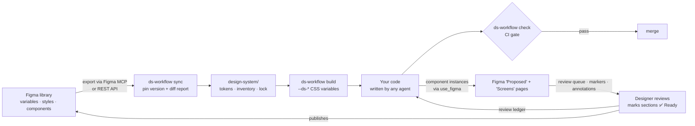

# Agent with Figma Design System

**Make your AI coding agents follow your Figma design system, and make every change in code show up as real components in Figma.**

Works with any coding agent — Codex, Cursor, Claude Code, GitHub Copilot, Gemini CLI, Cline, or anything that reads `AGENTS.md` — and with people. Zero dependencies. MIT.

[English](README.md) · [中文](README.zh-CN.md)

[](https://github.com/Tuzibaobaobai/Agent-with-Figma-Design-System/actions/workflows/test.yml)


---

## Why

AI agents write UI fast, but they don't stick to a design system:

- They make up hex colours, `13px` paddings and font names.
- They rebuild a button that already exists in your Figma library.
- When they "send it to Figma", designers get flat layers they can't edit.
- When the designer ships a new version of the library, nobody knows which code is now out of date.
- They overwrite screens the designer already finished, and the designer never hears that something changed.

Prompting harder doesn't fix this. **Agent with Figma Design System** gives the agent rules to follow and checks its output against them:

| | |
| --- | --- |
| 🎯 **One source of truth** | Figma variables and styles become pinned, versioned design tokens (DTCG) and generated CSS custom properties. Nobody hand-edits them. |
| 🧱 **Reuse → extend → propose** | Agents map every UI element to a library component first. If nothing fits, they add a variant. Only after that do they propose a new component on a "Proposed" page for the designer to approve. A registry tracks every decision. |
| 🚦 **A gate the agent can't argue with** | `ds-workflow check` runs in CI. It fails on unknown tokens, colour literals, font names and `px` in the component library. Literal counts in legacy code can only go down. |
| 🔁 **Round-trip with Figma** | Agents write screens back to Figma as **component instances** through the Figma MCP server, not as screenshots. They also align code with the sections the designer marks **Ready for dev**. |
| 👀 **A review loop the designer can live in** | Every UI change goes back to the designer automatically. Finished screens are never overwritten (a v2 goes beside them). Reminders go where the designer works — a review-queue board, name markers and annotations in Figma, or issues. A review ledger in the repo records what is Ready and what is waiting, and `review --strict` holds production releases until the designer signs off. |
| 🆙 **Safe upgrades** | Every sync pins a version. Each new library release produces a diff report (removed, renamed and changed tokens; changed component properties) and a migration checklist. |
| 🤝 **Agent-agnostic** | The rules are plain Markdown placed where each agent already looks (`AGENTS.md`, Cursor and Copilot rule files, `CLAUDE.md` / `GEMINI.md` imports, Cline rules, any skill folder). All state is in repo files, so several agents and people can share a project. |

## How it works



## Quick start

```sh
# 1. Install (from GitHub)
npm i -D github:Tuzibaobaobai/Agent-with-Figma-Design-System

# 2. Set up your project: config, design-system/ folder, CI gate, AGENTS.md block, Cursor rule, playbooks
npx ds-workflow init --name "Acme DS" --prefix acme \
  --source <Figma link | design-system.html>   # see "Where the design system comes from"
  --agents cursor,copilot,claude               # the agents your team uses (default: the ones found in the repo)

# 3. Pin the design system (init printed the steps for your source):
#    Figma: ask your agent to "follow docs/ds-workflow/ds-adopt/SKILL.md" — it runs the export script through
#    the Figma MCP server (every plan, sees unpublished styles) — then
npx ds-workflow sync --label DS-2025-01-15
#    HTML export: the same command reads the page. Figma Enterprise token: add --figma

# 4. Generate tokens and turn on the gate
npx ds-workflow build
npx ds-workflow check            # existing project: review, then `check --update` once to record a baseline
```

Then use your agent as usual. It reads the rules from `AGENTS.md` and the playbook for the task, and CI keeps it honest.

```css
/* what your agent now writes */
.card {
  background: var(--acme-color-background-card);
  border-radius: var(--acme-radius-l);
  font: var(--acme-text-body-m-size) / var(--acme-text-body-m-line-height) var(--acme-font-family-primary);
}
```

## Where the design system comes from

`--source` on `init`, or later `npx ds-workflow source <link | file>`, records it in `designSystem.source`, refreshes the agent rules and prints the next steps. `npx ds-workflow source` alone shows the current one.

| You have | Command | What happens |
| --- | --- | --- |
| **A link to a Figma design file**, or into one: `https://www.figma.com/design/<file_key>/<file_name>?node-id=<node_id>` | `source <link>` | Kind `figma-file`. The file key (after `design/`) is what every Figma MCP call needs; `node-id` (`12-345` in links, `12:345` in the API) marks where to start. Tracking parameters are dropped; branch links use the branch key. |
| **A public kit from the Figma Community** — Material Design 3, Apple's UI kits, Tailwind / shadcn/ui / Ant Design kits… | `source <Community link>`, then `source <your copy's link> --from-community <Community link> --license "…"` | Kind `figma-community`. Tools cannot read a Community page: check the licence, "Open in Figma" to duplicate it, move the copy into your team, and use the copy. The original is never edited; a new kit version means a new copy and a new label. |
| **Your team's published library** (in the library file: Share → Copy link, or the address bar) | `source <link> --library [--work-file <link>]` | Kind `figma-library`. Proposals and screens go to `--work-file` when the project may not edit the library; there they use the library's components as instances. |
| **An HTML design system the designer exported for the project** | `source design-system.html [--components <Figma link>]` | Kind `html`. Copied into `design-system/source/` and pinned by hash. `sync` reads tokens from embedded JSON (a ds-workflow export, Figma-like data or DTCG tokens) or CSS custom properties; components come from the Figma file given with `--components`. |

Every kind accepts `--work-file <Figma link>`: the file where this project puts proposals and written-back screens (default: the design system file itself). `design-system/lock.json` records the origin (kind, link, file key, Community origin, licence, HTML hash) with every pinned version.

## What each agent gets

`init` (later `rules`) writes everything in one go and never touches your own text. `AGENTS.md` is always written; the other targets come from `--agents` / `agents.targets` (default `auto`: the agents whose files already exist in the repo).

| Target | Where the rules go |
| --- | --- |
| `agents-md` (always) | A managed block in `AGENTS.md`: the hard rules plus the playbook index. Codex and the many other agents that read `AGENTS.md` need nothing else |
| `cursor` | `.cursor/rules/ds-workflow.mdc`, attached when style or component files are edited |
| `copilot` | `.github/instructions/ds-workflow.instructions.md` with `applyTo` set to style and component files |
| `claude` | `@AGENTS.md` imported from `CLAUDE.md` (created if missing) |
| `gemini` | `@AGENTS.md` imported from `GEMINI.md` (created if missing) |
| `cline` | `.clinerules/ds-workflow.md`, or the block inside a `.clinerules` file |
| any other agent | `agents.extraFiles`: the same managed block in any instruction file you name |
| skills | `--skills-dir <folder>` / `agents.skillsDirs`: the playbooks as `SKILL.md` folders, for every agent that loads skills (e.g. `.claude/skills`) |
| everyone, humans included | Playbooks copied to `docs/ds-workflow/`, updated with the package version |

### What differs between agents

The playbooks rely on the Figma MCP server, not on any one agent's features:

- **No Figma write access?** The agent finishes the code; someone with write access does the Figma steps. Nothing is replaced by screenshots.
- **No sub-agents?** Large mappings run area by area instead of in parallel; the final completeness review stays.
- **No memory between sessions?** Not needed: the pinned version, registry, proposals and review ledger are all files in the repo, and the CI gate checks them whoever wrote the code.

See "Working with different agents" in `playbooks/README.md`.

## Playbooks

Step-by-step procedures for agents, written in `SKILL.md` format:

| Playbook | Use it when |
| --- | --- |
| `ds-adopt` | Bringing an existing codebase onto the design system |
| `ds-map` | Mapping screens and elements to library components and tokens; listing the gaps |
| `ds-propose` | A component, variant or token is missing: propose it in Figma for the designer |
| `ds-implement` | Building components and pages from the registry with tokens only |
| `ds-write-back` | Putting screens back into Figma as component instances |
| `ds-review-loop` | Any UI change: send it to the designer, never overwrite finished screens, keep the review ledger |
| `ds-align-ready-for-dev` | The designer marked sections **Ready for dev**: align the code to them |
| `ds-upgrade` | The library has a new version: sync, diff, migrate, verify |
| `reference/figma-gotchas` | Plugin-API pitfalls collected from real use |

## Commands

| Command | What it does |
| --- | --- |
| `init` | Config, `design-system/` skeleton, CI workflow, agent rules, playbooks (never overwrites without `--force`) |
| `source [<link \| file.html>]` | Set or show where the design system comes from (`--library`, `--from-community`, `--license`, `--components`, `--work-file`) |
| `sync` | Pin the design system from the configured source: the plugin exports in `design-system/source/`, or the HTML file; `--export <files…>`, `--html <file>` and `--figma` (REST API) choose explicitly. Writes a migration diff when the version changes |
| `build` | Tokens → CSS custom properties (aliases become `var()`, extra modes become `[data-<collection>="<mode>"]`) |
| `check [--update]` | The gate. `--update` lowers the baseline, and only after a migration |
| `registry` | `components.registry.json` → a readable Markdown table for designers and reviews |
| `review [--strict]` | Print the review ledger (Ready / unconfirmed / waiting); `--strict` fails while anything waits for the designer — run it before production releases |
| `rules [--skills-dir <folder>]` | Refresh the agent rules and playbook copies after an upgrade |
| `paths` | Print where the playbooks and the Figma export script live |

## What `check` enforces

- `var(--<prefix>-*)` must exist in the pinned version.
- `font-family` must be a `var(…)` (except inside `@font-face`).
- In the component library: no `px` (except `0` and media queries), and no custom properties that are neither tokens nor defined in the same file.
- Hard-coded colours and literals in legacy token files are counted per file, and the count may only go down.
- Registry: valid statuses; `reuse` / `extend` / `approved` entries must point at a node id in the pinned inventory; proposals use the proposal prefix; no duplicates.
- Review ledger: well formed; nothing waiting for review is a node the designer marked Ready or that is unconfirmed (changes to those go in a v2 beside them).

## Configuration

`design-system.config.json`. Every key is optional.

| Key | Default | Meaning |
| --- | --- | --- |
| `designSystem.name` | — | Library name |
| `designSystem.source` | — | Where the design system comes from; set it with `source` (`kind`, `url`, `fileKey`, `nodeId`, `communityUrl`, `license`, `html`, `components`, `workFile`). A 0.1 config with only `figmaFileKey` keeps working |
| `designSystem.proposalPage` / `screensPage` | `Proposed` / `Screens · {label}` | Figma pages for proposals and written-back screens |
| `proposal.prefix` | `Proposed` | Proposed components are named `Proposed/<Area>/<Name>` in Figma and `proposed/…` in code |
| `tokens.prefix` / `css` / `proposed` | `ds` / `src/styles/ds-tokens.css` / `design-system/tokens/proposed.tokens.json` | CSS variable prefix, generated CSS, proposed tokens |
| `check.scan` / `componentDirs` / `legacy` / `extensions` / `ignore` | `src` / `src/ui` / `[]` / common front-end files / tests and stories | Scope of the gate |
| `registry.markdown` | `docs/design/component-registry.md` | Generated registry table |
| `playbooks.dir` | `docs/ds-workflow` | Where playbooks are copied |
| `agents.targets` / `skillsDirs` / `extraFiles` | `auto` / `[]` / `[]` | Which agents get the rules; skill folders; any other instruction files |
| `review.channel` | `figma` | Where the designer is reminded: `figma` (review-queue board, name marker, annotations), `issue`, or `both` |
| `review.ledger` / `readyMarker` / `pendingMarker` / `annotationCategory` / `queueName` | `design-system/figma-review.json` / `✅ Ready` / `· 🟡 In review` / `Design review` / `Review queue` | The review ledger and the names used in Figma |

## FAQ

**Do I need Figma Enterprise?** No. The default path runs `figma/export-design-system.js` through the Figma MCP `use_figma` tool, which works on every plan and also sees local, unpublished variables and styles. The REST path is optional and needs Enterprise for variables. An HTML export needs no Figma access at all for the tokens.

**Can I start from Material 3, Apple's UI kits or another Community kit?** Yes: duplicate it, point `source` at your copy with `--from-community`, and record its licence. Some kits restrict where their designs may be used — read the terms on the Community page.

**Does it work with Tailwind, CSS Modules or styled-components?** The output is plain CSS custom properties, so anything that can read `var(--…)` works. The gate scans CSS, SCSS, JS and TS files.

**Will it fight with my existing `AGENTS.md`?** No. It only manages the block between its own markers.

**Is this battle-tested?** It was extracted from a production project that moved several products onto one Figma library over multiple library releases, with project-specific details removed.

## Known limits

- Figma's plugin API can't read the **Ready for dev** mark (`devStatus`). The designer adds a marker to the section name (default "✅ Ready"), and the review ledger records it.
- `use_figma` returns at most about 48 KB per call, so the export runs in parts and chunks and the agent saves each chunk. Large libraries take several runs.
- The REST styles and components endpoints only return published items.
- No screenshot-diff tool is bundled. The `ds-implement` playbook describes visual regression with your own e2e tooling.
- Code Connect is not wired in yet. It also needs Dev seats on a Figma Organization or Enterprise plan; the registry links code and Figma without it.

## Roadmap

- [ ] Publish to npm
- [ ] Code Connect mappings generated from the registry
- [ ] Optional Tailwind theme output
- [ ] Built-in visual-regression helper

Ideas and PRs are welcome. Open an issue first for bigger changes.

## Development

```sh
npm test    # node --test, no dependencies
```

After changing playbooks or templates, bump the version. Projects run `npm update` and then `npx ds-workflow rules` to refresh their copies.

## License

[MIT](LICENSE)

---

If this saves your team from one more `#3B82F6` in a pull request, please ⭐ the repo so other teams can find it.
