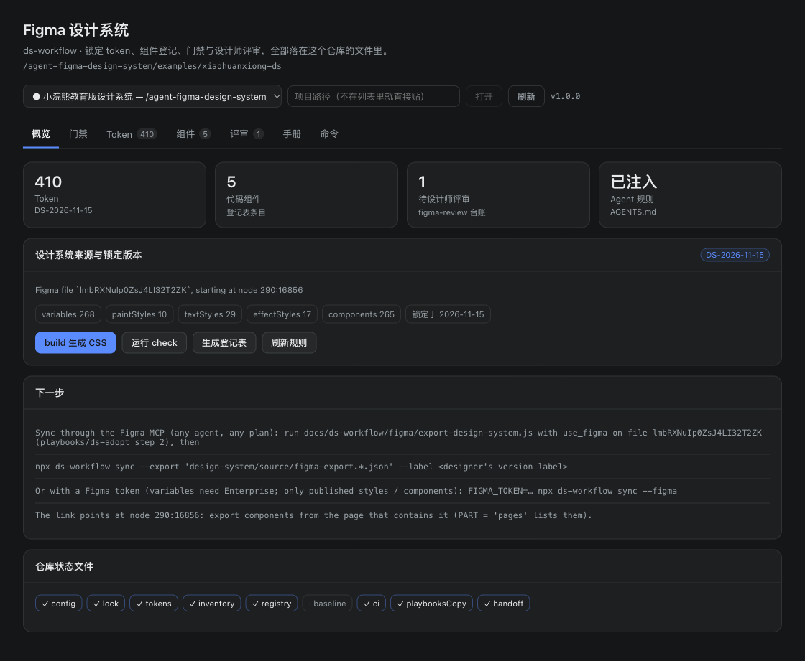

# dsh-figma-ds

The `ds-workflow` design system workflow as a **DeepSeek Harness plugin**: the pinned
tokens, the component registry, the check gate, the designer review ledger and the eight
agent playbooks become one page in the Harness Web UI.

It is an integration inside this repository, not a separate package: its Host half
imports the toolkit from `../../lib`, and the template/playbook resolution in
`lib/rules.mjs` already points at this repository's root. **Install it from a checkout
of this repository** (see below); it is not meant to be published on its own.

| Was (CLI) | Is (plugin page) |
| --- | --- |
| `npx ds-workflow check` in a terminal | 「门禁」tab: run the gate, see every violation, `--update` the literal baseline |
| `design-system/tokens/names.json` | 「Token」tab: every pinned / proposed token with its Figma path and status |
| `design-system/components.registry.json` | 「组件」tab: code component ↔ Figma component, grouped by the reuse / extend / proposed / approved / deprecated state machine |
| `design-system/figma-review.json` | 「评审」tab: signed-off sections, unconfirmed ones, what waits for the designer, strict release check |
| `playbooks/*/SKILL.md` | 「手册」tab: the eight playbooks agents read, viewable in place |
| `npx ds-workflow <command>` | 「命令」tab: init / source / sync / build / check / registry / review / rules, each with its live output |

The page calls the same `lib/` functions the CLI calls, in-process, and shows structured
results instead of terminal text. Everything still lives in repository files, so any
coding agent — not only the one running Harness — sees the same state.



## Install

The plugin is a **bundle**: a package whose `package.json` declares `dsh.bundle.patch`,
installed into a Harness profile as a linked local directory.

```bash
# CLI
dsh plugin --profile <profile> add "$(pwd)/integrations/dsh-figma-ds"

# or the Web UI → Plugins → install → paste the absolute path
# or the agent tool: plugin_manager { action: "install_bundle", target: "<absolute path>" }
```

The **Host half of a bundle only loads on a fresh Harness process**, so restart Harness
once after installing or updating `index.js`. The page then appears in the sidebar as
「设计系统」.

Requirements: Node ≥ 20 (the repository's `engines`) and a Harness whose client exposes
the `main` and `sidebar.panellist` slots. The Desktop profile is managed by the app, so
install it from the app's Plugins page or through `plugin_manager`.

## Where it reads and writes

The Host half runs unsandboxed, so the page may only open directories inside a fixed
allowlist: every registered Harness workspace, plus `DSW_PROJECT_DIR` (one directory)
and `DSW_PROJECT_DIRS` (several, separated by the platform path delimiter). Those two
variables belong to the environment that starts the Harness, so set them before a
restart.

The picker lists each workspace and the directories one level below it that already
contain `design-system.config.json`; a project with a pinned version sorts first. A
project outside that set can still be opened by pasting its absolute path into the
page's path box — the Host validates it against the same allowlist.

Most commands write into the project directory (`init`, `source`, `sync`, `build`,
`registry`, `rules`, `check --update`); `check` and `review` without flags are
read-only. Commands run one at a time per directory — the toolkit writes without a lock.

## What the page cannot do

The Figma side stays an MCP operation, because it runs inside Figma:

- exporting variables / styles / components — `figma/export-design-system.js` runs
  through `use_figma` (chunked, ≈48 KB per call); save the JSON files under
  `design-system/source/` and use `sync`,
- proposing components, writing screens back as instances, leaving review annotations.

The 「手册」tab shows the playbook for each of those steps (`ds-adopt`, `ds-propose`,
`ds-write-back`, `ds-review-loop`, `ds-align-ready-for-dev`, `ds-upgrade`, `ds-map`,
`ds-implement`).

## Run the example

[`examples/xiaohuanxiong-ds`](../../examples/xiaohuanxiong-ds) is a real project pinned to
a Figma library: 268 variables, 265 components, 410 generated tokens, a five-entry
registry and a review ledger. Open it in the page's project picker, or from the command
line:

```bash
cd examples/xiaohuanxiong-ds
node ../../bin/ds-workflow.mjs check      # 1 error by design (a drifting component)
node ../../bin/ds-workflow.mjs registry
node ../../bin/ds-workflow.mjs review
```

The step-by-step walkthrough, with screenshots, is
[docs/tutorial-xiaohuanxiong.md](docs/tutorial-xiaohuanxiong.md).

## Test

```bash
node integrations/dsh-figma-ds/tests/smoke.mjs          # from the repository root
node integrations/dsh-figma-ds/tests/smoke.mjs <dir>    # or against another project
```

The smoke test exercises the same functions the page calls (allowlist, state reader,
command runner, playbook reader) against `examples/xiaohuanxiong-ds`, with no Harness
running.

## Layout

```
index.js              Host half: allowlist, state reader, the nine commands, /api/figma-ds routes
client.js             Client half: sidebar icon + 「设计系统」page (plain JS, no build step)
cordis.patch.yml      the one Loader row that activates the Host half
locale/{en,zh}.json   Plugin Manager title and description
icon.svg              original artwork
docs/                 the tutorial and its screenshots
tests/smoke.mjs       Host-half checks
```

## Notes

- The Host half is plain ESM and imports only `../../lib/*.mjs` plus Node built-ins; it
  adds no runtime dependency to this repository.
- Screenshots in `docs/images/` are the page rendering the example project's real state;
  only the `/api/figma-ds/*` transport is stubbed when they are produced.
- MIT, like the rest of this repository.
