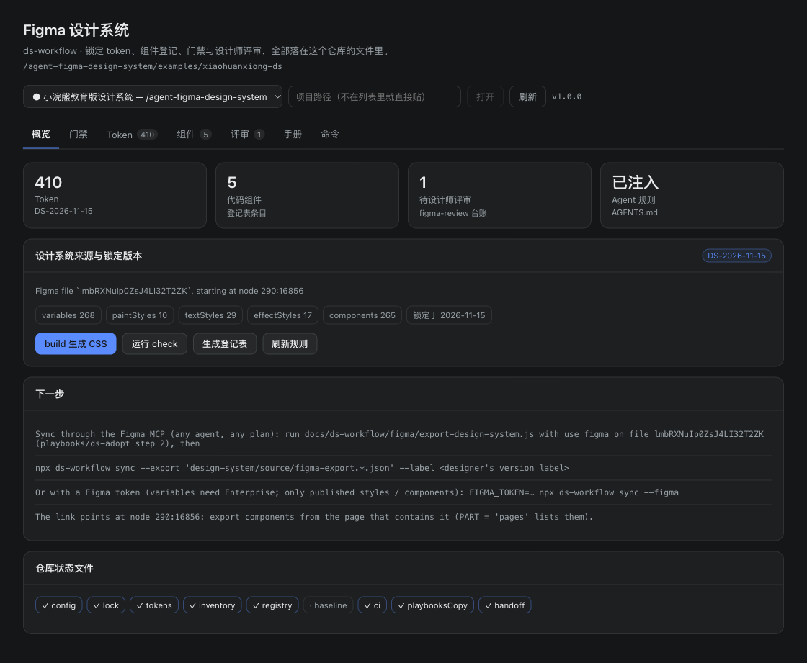
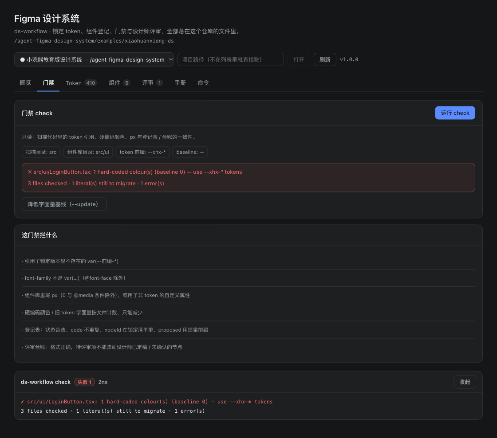
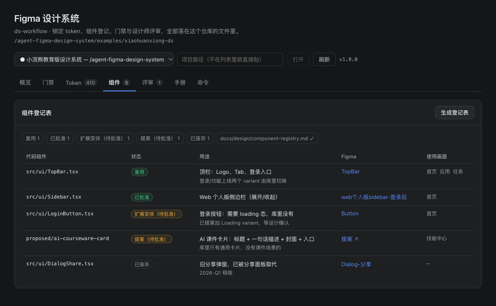
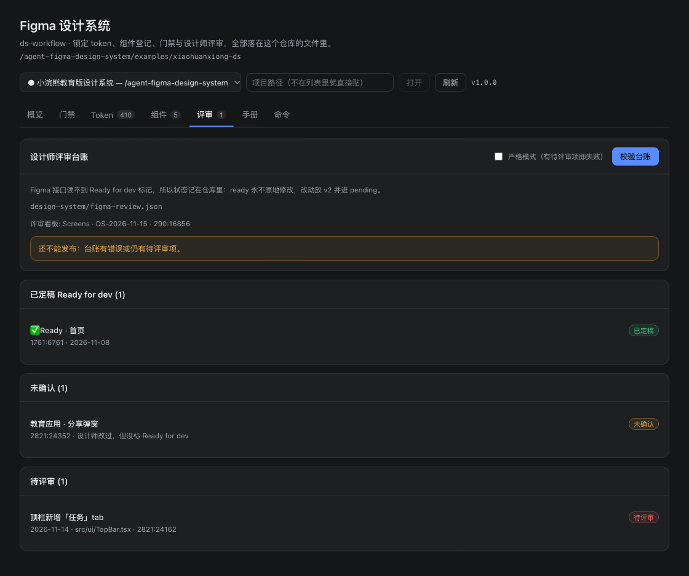
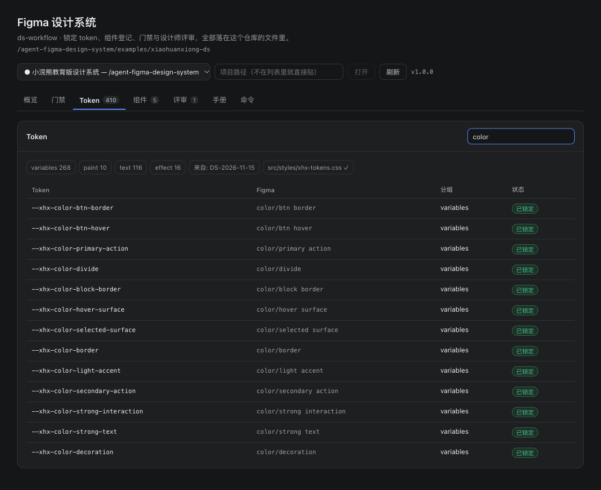
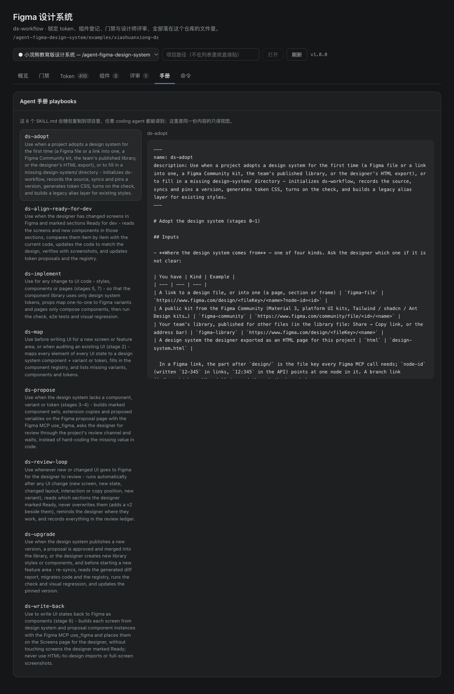
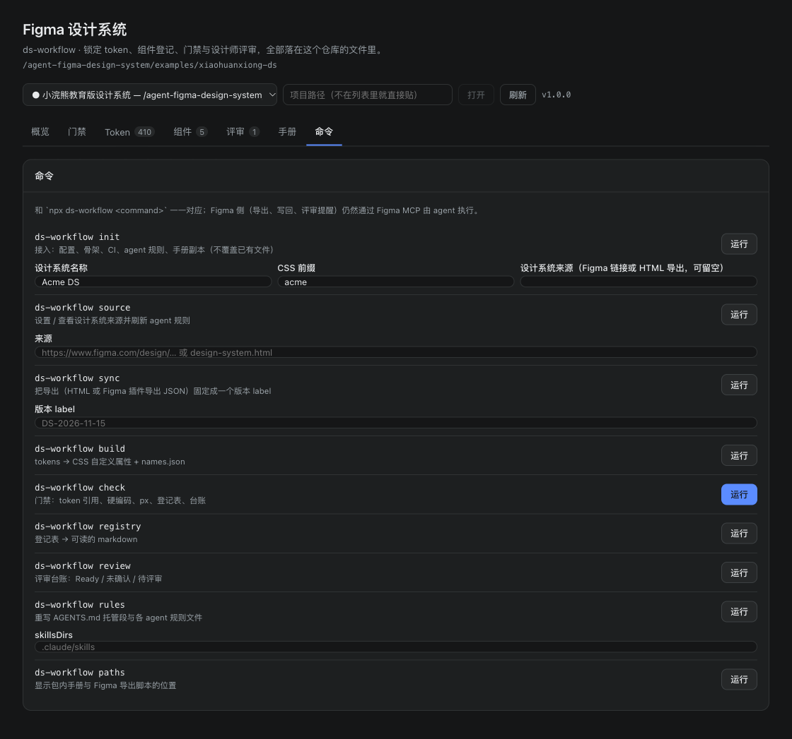

# dsh-figma-ds 使用教程 · 以「小浣熊教育版」设计系统为例

> 示例设计文件：<https://www.figma.com/design/lmbRXNuIp0ZsJ4LI32T2ZK/小浣熊教育版?node-id=290-16856>
> 本文所有数字都来自这次真实跑通的结果，不是示意值。
> 示例工程：`examples/xiaohuanxiong-ds/`（仓库根目录下）；插件本体：`integrations/dsh-figma-ds/`

---

## 0. 一句话理解这个插件

`dsh-figma-ds` 把 [`Agent-with-Figma-Design-System`](https://github.com/Tuzibaobaobai/Agent-with-Figma-Design-System)（命令 `ds-workflow`）搬进 DeepSeek Harness：

- **状态仍然放在仓库文件里**（`design-system/`、生成的 token CSS、`AGENTS.md` 托管段、评审台账），任何 coding agent 都能读；
- **原来在终端里敲的 8 个命令，变成侧边栏「设计系统」页里的按钮和数据**；
- **Figma 侧的操作仍然由 agent 通过 Figma MCP 完成**（导出、提案、写回、评审提醒），因为那些必须在 Figma 里执行。

| 原来（终端） | 现在（插件页面） |
| --- | --- |
| `npx ds-workflow check` | 「门禁」tab：点「运行 check」，逐条列出违规 |
| `design-system/tokens/names.json` | 「Token」tab：410 个 token，搜索 + 分组 + 状态 |
| `design-system/components.registry.json` | 「组件」tab：代码组件 ↔ Figma 组件、五种状态 |
| `design-system/figma-review.json` | 「评审」tab：已定稿 / 未确认 / 待评审，严格模式 |
| `playbooks/*/SKILL.md` | 「手册」tab：8 个 agent 手册只读查看 |
| `npx ds-workflow init/source/sync/build/…` | 「命令」tab：带参数表单的命令行，输出在底部浮动面板 |

插件的 Host 半边直接 import 仓库里的 `lib/*.mjs`（不再单独打包一份 CLI），**目标项目不需要再安装 CLI**。



*图 1：示例工程在插件页面里的样子——已接入、钉在 `DS-2026-11-15`，410 个 token / 5 条登记 / 1 条待评审。*

> 本文截图是插件页面组件的真实渲染：数据由插件 Host 半边从 `examples/xiaohuanxiong-ds/` 读出，
> 页面通过 Harness 的 `/api/figma-ds/*` 与 Host 通信（截图时只替换了这一层传输）。
> 截图里的项目路径按仓库布局显示为 `/agent-figma-design-system/examples/xiaohuanxiong-ds`。


---

## 1. 安装与打开

```
Plugins → 安装 → 粘贴本目录绝对路径
# 或让 agent 执行：plugin_manager { action: "install_bundle", target: "<绝对路径>" }
```

安装后 **重启一次 Harness**（Host 半边的 JS 只有重启才会重新加载；只刷新页面不够）。
重启后侧边栏出现「设计系统」，点进去就是主页面。

页面顶部的项目选择器列出两类目录：

- Harness 里已注册的每个 workspace；
- workspace 里**下一层**已经带 `design-system.config.json` 的项目目录。

最优先显示「已接入且有锁定版本」的项目。列表里没有的项目，把**绝对路径**粘进右上角输入框点「打开」即可（Host 仍会做白名单校验，只能打开允许范围内的目录；范围由 workspace 列表加 `DSW_PROJECT_DIR` / `DSW_PROJECT_DIRS` 环境变量决定）。

---

## 2. 第一次接入一个项目

在页面「概览」→「接入一个项目」里填三项，点「初始化项目」：

| 字段 | 本例填写 |
| --- | --- |
| 设计系统名称 | `小浣熊教育版设计系统` |
| CSS 前缀 | `xhx` |
| 设计系统来源 | 上面那条 Figma 链接（可留空，之后再 `source`） |
| Agent 目标 | `agents-md`（默认；也可以 `agents-md,cursor,copilot,claude`） |

等价的命令行：

```bash
npx ds-workflow init \
  --name "小浣熊教育版设计系统" \
  --prefix xhx \
  --source "https://www.figma.com/design/lmbRXNuIp0ZsJ4LI32T2ZK/小浣熊教育版?node-id=290-16856" \
  --agents agents-md
```

`init` 做的事（都不会覆盖已有文件，只会列出 `kept`）：

- 写 `design-system.config.json`：唯一需要人维护的输入；
- 建 `design-system/` 骨架：`lock.json 尚未生成`、`tokens/`、`components.registry.json`、`figma-review.json`、`migrations/`、`source/`；
- 写 `.github/workflows/ds-check.yml`（CI 里跑门禁）与 `docs/design/handoff-design-system.md`；
- 写 `AGENTS.md` 的托管段，并把 8 个 playbook 复制到 `docs/ds-workflow/`；
- 有 `package.json` 时补 `ds:check / ds:build / ds:registry / ds:rules` 脚本。

本例执行结果：

```
created / updated:
  design-system.config.json
  design-system/README.md
  design-system/components.registry.json
  design-system/tokens/proposed.tokens.json
  design-system/figma-review.json
  design-system/migrations/legacy-tokens.md
  design-system/source/.gitkeep
  .github/workflows/ds-check.yml
  docs/design/handoff-design-system.md
  AGENTS.md
  docs/ds-workflow/ (playbooks + figma/export-design-system.js)

source: Figma file `lmbRXNuIp0ZsJ4LI32T2ZK`, starting at node 290:16856
```

---

## 3. 第二步：让 agent 从 Figma 导出设计系统（插件不代劳）

这是**唯一必须回到对话里做的事**：`figma/export-design-system.js` 要在 Figma MCP 的 `use_figma` 里执行，页面无权跑。

对 agent 说：

> 用 use_figma 在 file `lmbRXNuIp0ZsJ4LI32T2ZK` 上跑 `docs/ds-workflow/figma/export-design-system.js`，
> 先 `PART='pages'`，再 `PART='variables'`、`PART='styles'`、`PART='components'`，
> 每块原样存成 `design-system/source/figma-export.*.json`。

脚本只改三行：`PART`（`pages|variables|styles|components`）、`CHUNK`、`PAGE_ID`。`use_figma` 单次返回约 48 KB，所以脚本按 40 KB 切块，返回值里有 `chunk` / `chunks`，`chunk + 1 === chunks` 才算导完。

本例的真实导出（`web端` 页面，page id `290:16856`）：

| 部分 | 块数 | 内容 | 落盘文件 |
| --- | --- | --- | --- |
| pages | 1 | 9 个页面：web端 / 客户端 / Light&Dark / … | 不用存 |
| variables | **2** | 6 个变量集合（semanticColors、primitiveColors、space、responsive、map、font），268 个变量 | `figma-export.variables.0.json`（167）、`.1.json`（101） |
| styles | **1** | 10 个 paint、29 个 text、17 个 effect 样式 | `figma-export.styles.0.json` |
| components | **2** | `web端` 页面 265 个组件 / 组件集 | `figma-export.components.web端.0.json`（198）、`.1.json`（67） |

> 页面里 98 个组件集 + 432 个组件，脚本只取「组件集本身」和「不在组件集里的组件」，所以是 265 条——variant 归属于它的 set，不重复登记。

---

## 4. 第三步：`sync` 锁定一个版本

页面「命令」tab → `sync`（填版本 label）→ 运行；或：

```bash
npx ds-workflow sync --label "DS-2026-11-15"
```

它会读 `design-system/source/figma-export.*.json`，把设计系统**钉死**在这个版本上：

```
DS-2026-11-15: {"variables":268,"paintStyles":10,"textStyles":29,"effectStyles":17,"components":265} pinned
```

产物：

- `design-system/lock.json`：版本 label、来源（fileKey）、日期、各类数量、输出文件哈希；
- `design-system/tokens/design-system.tokens.json`：DTCG 形式的 token；
- `design-system/components.inventory.json`：组件清单（node id、名字、页面、所在 frame、属性）；
- 有变化时生成 `design-system/migrations/<旧>→<新>.md` 升级报告。

**这一步是全流程的关键**：之后所有「这个 token / 这个组件是否存在」的判断，都以这个 label 为基准，代码和 Figma 就有了一把共同的尺子。

---

## 5. 第四步：`build` 生成 CSS 变量

「概览」卡片可直接点「build 生成 CSS」，或：

```bash
npx ds-workflow build
```

```
src/styles/xhx-tokens.css: 410 tokens {
  'variables/pinned': 268, 'paint/pinned': 10, 'text/pinned': 116, 'effect/pinned': 16
}
```

命名规则（`tokens.prefix` + Figma 路径小写）：

| Figma | CSS 变量 |
| --- | --- |
| `color/primary action` | `--xhx-color-primary-action` |
| `text/primary` | `--xhx-text-primary` |
| `radius/m` | `--xhx-radius-m` |
| `height/btn/m` | `--xhx-height-btn-m` |
| `Font system/S/medium`（文本样式） | `--xhx-text-font-system-s-medium`（字体简写）、`…-size`、`…-line-height`、`…-weight` |
| `shadow`、`btn-s`（效果样式） | `--xhx-effect-shadow`、`--xhx-effect-btn-s` |

同时写 `design-system/tokens/names.json`——门禁靠它判断「这个变量名是不是本版本的 token」。

写代码时就应该这样用：

```css
.xhx-topbar {
  height: var(--xhx-height-topbar);
  background: var(--xhx-surface-canvas);
  border-bottom: 1px solid var(--xhx-color-divide);
  box-shadow: var(--xhx-effect-shadow);
}
.xhx-topbar__tab {
  font: var(--xhx-text-font-system-s-medium);
  color: var(--xhx-text-secondary);
}
```

---

## 6. 第五步：`check` 门禁——插件的核心价值

示例项目里故意留了一个「漂移」组件，用来验证门禁确实会拦：

```tsx
// src/ui/LoginButton.tsx
background: '#7C4DFF',   // ✗ 硬编码颜色
```

「门禁」tab 点「运行 check」：

```
3 files checked · 1 literal(s) still to migrate · 1 error(s)
✗ src/ui/LoginButton.tsx: 1 hard-coded colour(s) (baseline 0) — use --xhx-* tokens
```




*图 2：门禁 tab——点「运行 check」后，违规逐条列出，底部面板给出退出码与统计。*

修法只有一句：把它换成锁定的 token（本例 `var(--xhx-color-primary-action)`），再跑一次：

```
3 files checked · 0 literal(s) still to migrate · 0 error(s)
```

门禁拦什么：

1. `var(--xhx-*)` 不在本版本 `names.json` 里；
2. `font-family` 不是 `var(…)`（`@font-face` 除外）；
3. `check.componentDirs`（默认 `src/ui`）里写 px（0 与 `@media` 条件除外）、用非 token 的自定义属性；
4. 硬编码颜色 / 旧 token 字面量按文件计数，只许降不许升；
5. 组件登记表：状态合法、code 不重复、node id 在锁定清单里、proposed 用提案前缀；
6. 评审台账：格式正确，待评审条目不能改设计师已定稿 / 未确认的节点。

迁移期实在要先把历史欠账压下来，用「降低字面量基线（--update）」——它只更新基线，不会替你改代码。

CI 里同一个门禁：`init` 已写好 `.github/workflows/ds-check.yml`，谁写的代码都一样。

---

## 7. 第六步：`registry` 组件登记表

「组件」tab 展示 `design-system/components.registry.json`；点「生成登记表」会额外写出 `docs/design/component-registry.md`（给设计师和评审 issue 看的表格）。

本例 5 条，覆盖全部五种状态：

| code | 状态 | 说明 | Figma |
| --- | --- | --- | --- |
| `src/ui/TopBar.tsx` | `reuse` 复用 | 顶栏 | `TopBar` `2256:37070` |
| `src/ui/Sidebar.tsx` | `approved` 已批准 | 个人版侧边栏（展开/收起） | `web个人版sidebar-登录后` `2367:5427` |
| `src/ui/LoginButton.tsx` | `extend` 扩展变体（待批） | 需要 Loading 态，库里没有 | `Button` `2541:7889` |
| `proposed/ai-courseware-card` | `proposed` 新组件（待批） | 课件卡片 | 提案 `412:88` |
| `src/ui/DialogShare.tsx` | `deprecated` 已废弃 | 旧分享弹窗 | `Dialog-分享` `2821:31581` |

状态机规则：

- `reuse` / `extend` / `approved`：`figma.nodeId` 必须出现在锁定版本的组件清单里，写错 node id 直接报错；
- `proposed`：`code` 必须以 `proposed/` 开头（Figma 里叫 `Proposed/…`），并给 `figmaProposal` 链接；
- `deprecated`：不校验，但要写清替代品；
- `figmaPending` 是**字段**不是状态：表示「比锁定版本新的节点」，用于提醒下次 sync。

生成的 markdown：

```
5 entries: Reused 1, Approved 1, Extended with variants (awaiting approval) 1,
           New components (awaiting approval) 1, Deprecated 1.
```



*图 3：组件 tab——五种状态各一条，Figma 列直接链到对应节点或提案。*

---

## 8. 第七步：`review` 设计师评审回路

Figma API 读不到「Ready for dev」标记，所以状态记在仓库的 `design-system/figma-review.json`：

- `ready`：设计师标了 `✅ Ready` 的 section（永不原地改，改动另起 v2）；
- `unconfirmed`：设计师改过但状态不明，按 ready 对待；
- `pending`：等待评审的改动（必须指向新节点，不能指向 ready/unconfirmed 的节点）。

「评审」tab 可以勾「严格模式」再点「校验台账」——发布前必须通过（没有待评审项）。

```
design-system/figma-review.json
  ready for dev (1): ✅ Ready · 首页
  unconfirmed (1): 教育应用 · 分享弹窗
  waiting for review (1):
    2026-11-14  顶栏新增「任务」tab  [src/ui/TopBar.tsx]  2821:24162
```

加 `--strict` 时因为还有 1 条待评审 → 退出码 1，正好卡住生产发布。



*图 4：评审 tab——已定稿 / 未确认 / 待评审三段，右侧「严格模式」对应 `review --strict`。*

---

## 9. 页面导览：七个 tab 各看什么

| tab | 内容 | 会写文件吗 |
| --- | --- | --- |
| 概览 | 名称/来源/锁定版本、Token 数、组件数、待评审数、Agent 规则是否注入、下一步提示、仓库状态文件、常用动作 | 只有点动作按钮时 |
| 门禁 | 扫描目录、组件库目录、前缀、基线；运行 check 的结果；门禁规则清单 | `check --update` 会写基线 |
| Token | 410 个 token：CSS 变量名、Figma 路径、分组、状态；可搜索 | 否 |
| 组件 | 登记表：状态、用途、Figma 链接、变体、使用画面、备注；生成 markdown | 「生成登记表」写 markdown |
| 评审 | ready / unconfirmed / pending、台账错误、严格模式 | 否 |
| 手册 | 8 个 playbook 全文（`ds-adopt`、`ds-map`、`ds-propose`、`ds-implement`、`ds-write-back`、`ds-review-loop`、`ds-align-ready-for-dev`、`ds-upgrade`） | 否 |
| 命令 | init / source / sync / build / check / registry / review / rules / paths，输出显示在底部面板 | 视命令而定 |

每个动作只做一件事，输出面板保留最后一次的 stdout/stderr 与退出码；同一目录的命令**串行执行**（工具本身写盘无锁）。



*图 5：Token tab——410 个 `--xhx-*` 变量，可搜索，分组与状态一目了然。*



*图 6：手册 tab——8 个 playbook 的只读视图，左边选、右边读（这里打开的是 `ds-adopt`）。*



*图 7：命令 tab——每个命令一条，参数就地填；点「运行」后输出出现在页面底部的浮动面板里（图 2 可见）。*

---

## 10. agent 侧：规则与手册

`AGENTS.md` 里有一段托管文本（`<!-- ds-workflow:start … -->`），内容是本设计系统的硬规则 + 8 个手册索引。示例项目里这段已经生成（工具版本 0.2.0）。

- 其他 agent（Cursor / Copilot / Claude / Gemini / Cline）在 `init --agents` 里声明，或事后点「刷新规则」；
- 手册副本在 `docs/ds-workflow/`，每个是 `SKILL.md` 格式，agent 可以直接读；
- 设计师发新版 → 手册 `ds-upgrade`；设计师标 Ready → `ds-align-ready-for-dev`。

想让自己团队的 agent 也遵守，把这几条写进 README/PR 模板即可：**改 UI 必须用 `--xhx-*` token；新增组件先查登记表；`check` 不过不合并。**

---

## 11. 常见问题

| 现象 | 原因 / 处理 |
| --- | --- |
| 侧边栏没有「设计系统」 | 刚安装：需要**重启** Harness（Host 半边不会热加载） |
| 项目列表里没有我的项目 | 只列 workspace 本身和它的下一层；把绝对路径粘进右上角输入框「打开」，或把项目加为 workspace |
| `sync` 报「没有可同步的来源」 | 还没导出：先让 agent 跑 export 脚本，把 JSON 放进 `design-system/source/` |
| export 返回值被截断 | `use_figma` 单次约 48 KB；按返回的 `chunk/chunks` 逐块导出，每块原样落盘 |
| 想直接读 Figma REST | `sync --figma` 需要 `FIGMA_TOKEN`；variables 还要求 Enterprise 套餐，通常不如走 MCP 导出 |
| 改了 Figma 但页面没变 | 页面只读仓库；先 export → `sync` 换新 label → `build` |
| `check` 报「token 不存在」 | 用的变量名不在本版本 `names.json` 里：要么拼错，要么设计系统没同步 |
| 想改项目目录 / 换工作区 | 用页面选择器；`DSW_PROJECT_DIR`、`DSW_PROJECT_DIRS` 可加入额外允许目录（改完重启） |

已知限制（来自工具本身）：

- 「Ready for dev」标记 API 读不到，靠设计师在 section 名前加 `✅ Ready` 并记台账；
- 组件导出按页面、分块进行，大库要多次调用；
- 视觉回归只给做法（`ds-implement` 手册），不带截图对比工具；
- Code Connect 未接入（需要 Figma Organization/Enterprise 的 Dev 席位）；
- 工具写文件没有原子替换和锁，所以插件按目录串行，别并行跑命令。

---

## 12. 本例工程 `examples/xiaohuanxiong-ds/`

```
xiaohuanxiong-ds/
├── design-system.config.json          # 名称/前缀/来源/门禁范围…
├── design-system/
│   ├── lock.json                      # DS-2026-11-15 · 268/10/29/17/265
│   ├── tokens/
│   │   ├── design-system.tokens.json  # 钉住的 DTCG token
│   │   ├── names.json                 # 410 个 CSS 变量 ↔ Figma 路径
│   │   └── proposed.tokens.json       # 手写提案（本例空）
│   ├── components.inventory.json      # 265 个组件（node id 白名单）
│   ├── components.registry.json       # 5 条登记（五种状态各一）
│   ├── figma-review.json              # 1 ready / 1 unconfirmed / 1 pending
│   └── source/figma-export.*.json     # Figma MCP 导出的原始数据（5 个文件）
├── src/
│   ├── styles/xhx-tokens.css          # build 生成，勿手改
│   ├── styles/topbar.css              # 合规示例
│   └── ui/{TopBar,LoginButton}.tsx    # LoginButton 含一处故意漂移
├── docs/design/component-registry.md  # registry 生成的表格
├── docs/ds-workflow/                  # 8 个手册 + 导出脚本副本
├── .github/workflows/ds-check.yml     # CI 门禁
└── AGENTS.md                          # agent 规则托管段
```

复现命令（在 `examples/xiaohuanxiong-ds/` 里）：

```bash
node ../../bin/ds-workflow.mjs check                 # 1 error（演示用）
node ../../bin/ds-workflow.mjs registry              # 5 components
node ../../bin/ds-workflow.mjs review                # 1/1/1
node ../../bin/ds-workflow.mjs review --strict       # exit 1
```

或在 Harness 里安装插件后，用页面上的按钮跑同样的命令：

```bash
dsh plugin --profile <profile> add "$(pwd)/integrations/dsh-figma-ds"
```

---

## 13. 一轮完整流程（背下来这 8 步）

```
0. 安装插件 → 重启 Harness → 侧边栏「设计系统」
1. 概览里 init（名称 / 前缀 / Figma 链接）
2. agent 用 use_figma 跑 export 脚本 → 5 个 JSON 落进 design-system/source/
3. 点 sync（填 label）→ lock 住一个版本
4. 点 build → 生成 --xhx-* CSS 变量与 names.json
5. 写代码只用 token；提交前点 check
6. 新组件先查组件 tab / 登记表，再决定 reuse / extend / propose
7. 有 UI 改动就写回 Figma 并记 pending，等设计师标 ✅ Ready
8. 发布前 review --strict 必须通过
```

这套东西的价值不在「多了一个页面」，而在于：**设计系统、代码、评审状态三者都在同一个仓库里，人和任何 agent 看到的是同一份事实，门禁是自动的。**
